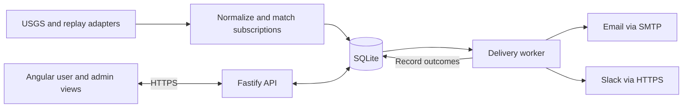

# Phase 1 World Event Alerts Design

Users should be able to choose which events matter to them and receive alerts through email, Slack, or both. Administrators should be able to see whether sources and deliveries are working. The first release uses an Angular web app, one TypeScript Node.js service, and SQLite. Event sources, subscription rules, and delivery channels can evolve independently.

[Assignment brief](P0-task-04-feature-design-and-build.docx) · [Prompt history](task-04-prompt-history.md)

## Scope and product decisions

| Area | Phase 1 decision | Reason and tradeoff |
| --- | --- | --- |
| Users | Start with provisioned user and admin accounts. Users can create, edit, pause, resume, and remove their own subscriptions, choose destinations, and view recent alert status. | Exercises access control and the core workflow. Self-service registration, recovery, and organization management can follow. |
| Importance | Each subscription selects an event type and a rule. Earthquakes use a minimum magnitude. News uses a publisher topic. Market movement uses a symbol and a minimum absolute percentage change between consecutive completed five-minute bars. Thresholds are inclusive. | Matching is predictable and testable. A news topic match carries no claim of editorial urgency. Each completed market interval can generate a new alert. |
| Sources | Poll USGS for earthquakes of magnitude 4.5 and above. Use a separate replay adapter for clearly labeled sample news and market events. | Exercises two adapters and all three categories within the 24-hour assignment. Live news and market integrations depend on credentials, permitted use, and latency. |
| Destinations | Email goes to the account's provisioned address. Slack users choose an allowed, named channel in one preconfigured workspace. A subscription can select either or both. | Supports real delivery with authorized credentials. Self-service Slack installation and direct messages require additional onboarding and permissions. |
| Administration | A role-protected, read-only view shows source status and last successful ingestion, recent normalized events, and delivery outcomes and attempt history. | A reviewer can distinguish a source failure, a missing match, and a send failure. |
| Speed and freshness | Poll USGS once a minute. Use a bounded catch-up window and backoff on failure. Initialize a checkpoint on first run to avoid alerting on the previous day's events. | The provisional target is queueing within two minutes of a qualifying event becoming visible in a healthy USGS feed. Measure this and set the freshness cutoff in Phase 2. |

The design assumes one deployment, one Slack workspace, and low event volume. Alerts are informational. Live news and market sources can move into the first release if access and terms are confirmed early.

## Architecture

Use one Node.js deployment with an HTTP API, source scheduler, and delivery worker loop. Angular uses standalone components, Angular Router, HttpClient, and Signal Forms for new forms. Serve separate subscription, account settings, and admin routes. The API enforces ownership and admin authorization. [Angular Signal Forms](https://angular.dev/guide/forms/signals/comparison)

| Module | Responsibility |
| --- | --- |
| Accounts and settings | Manage users, roles, sessions, and authorized destination references. |
| Subscriptions | Manage saved rules, active or paused state, and selected destinations. Match typed events against those rules. |
| Event sources | Own provider requests and credentials, payload validation, source checkpoints, and conversion to common events. |
| Ingestion | Deduplicate, handle source revisions, and persist events, matches, and pending delivery jobs in one transaction. |
| Notification delivery | Resolve the registered adapter by channel, format alerts, send them, and record outcomes and retries. Adapters receive an authorized destination and a channel-neutral alert. |
| Admin | Read source, event, match, and delivery records through a protected operations API. |

A normalized event has a source ID, provider event ID, event type, occurrence time, provider update time when available, title, and source link when available. Typed details hold earthquake magnitude, news topic, or a market symbol and percentage change. A market adapter can emit one observation per symbol and completed interval with a deterministic ID. User thresholds and destination selections stay with subscriptions. Source adapters have no account access, and delivery adapters have no dependency on source payloads or subscription rules.

Deduplicate repeated polls using the source and provider event ID. Apply newer revisions so a qualifying correction can trigger a first alert while the event is still eligible. Keep one delivery job per event and destination so overlapping subscriptions to the same channel do not post duplicates. Record which subscriptions matched. Before sending a queued job, check that at least one matching subscription still enables that destination. A provider call already in progress can finish after a pause.

Keep network calls outside database transactions. Retry transient failures with bounded backoff, honor provider rate limits, and surface permanent failures in admin. A timeout or crash after provider acceptance can still cause a duplicate on retry. The initial success state means provider acceptance. [Slack API rate limits](https://docs.slack.dev/apis/web-api/rate-limits/)

## Event source options

| Type | Candidate and integration | Considerations |
| --- | --- | --- |
| Earthquakes | **USGS GeoJSON**, the first live adapter. Poll an overlapping time window and map the feature ID, occurrence time, update time, and magnitude. [USGS feed documentation](https://earthquake.usgs.gov/earthquakes/feed/v1.0/geojson.php) | The public past-day feed updates every minute. A fixed provider ID allows revised magnitudes to update the existing event. |
| Other hazards | **National Weather Service API** for US weather alerts and **GDACS RSS or API** for more global hazards. [NWS API](https://www.weather.gov/documentation/services-web-api), [GDACS feed reference](https://www.gdacs.org/feed_reference.aspx) | Map severity, geography, updates, and cancellations per provider. Two providers reporting the same incident can create separate alerts until a correlation rule is established. |
| News | Poll the **Guardian Open Platform** by topic or section. A permitted RSS or Atom feed can follow the same polling model with XML parsing and item IDs. [Guardian access terms and limits](https://open-platform.theguardian.com/access/) | Confirm the key tier, quota, and redistribution rights before sending publisher content through Slack or email. |
| Market data | Poll **Alpha Vantage** for bars or receive **Alpaca** market data through WebSocket and build or consume completed bars. [Alpha Vantage API](https://www.alphavantage.co/documentation/), [Alpaca streaming market data](https://docs.alpaca.markets/us/docs/streaming-market-data) | REST is simpler. Streaming can reduce latency and requires reconnect, resubscribe, and gap recovery. Check entitlements, market hours, feed latency, and redistribution rights. |
| Provider-defined triggers | **TradingView** can push prepared observations over HTTP POST when a configured alert fires. [TradingView webhook setup](https://www.tradingview.com/support/solutions/43000529348-how-to-configure-webhook-alerts/) | Push avoids polling and ties each trigger to provider-side setup. Confirm endpoint authentication and retry behavior before adopting it. |

To add a source, register an adapter, define how it polls, streams, or receives events, and map its payload to a common event. Give the adapter its own timeout, backoff, checkpoint, and test fixtures so other sources can continue when it fails. A new provider for an existing event type reuses the existing rules. A new event type adds typed fields and a matching rule. To add a channel, register an adapter for destination validation, message formatting, and sending, with no change to source ingestion or matching.

## Email Slack and WebSocket choices

| Use | Choice and alternatives |
| --- | --- |
| Email | Use **Nodemailer over SMTP**. A configured relay handles external email. **Mailpit** captures local email for automated tests. **Resend** offers an HTTP API if provider-specific features become useful. [Nodemailer](https://nodemailer.com/smtp), [Mailpit](https://mailpit.axllent.org/docs/), [Resend send API](https://resend.com/docs/api-reference/emails/send-email) |
| Slack | Use **Incoming Webhooks** over HTTPS and keep URLs server-side behind destination aliases. Each webhook posts to its configured channel. Node fetch is enough for a POST. **@slack/webhook** is the official helper. **@slack/web-api** and **chat.postMessage** support choosing authorized conversation IDs with an installed app. [Slack Incoming Webhooks](https://docs.slack.dev/messaging/sending-messages-using-incoming-webhooks/), [Slack webhook SDK](https://docs.slack.dev/tools/node-slack-sdk/webhook/), [Slack message posting](https://docs.slack.dev/reference/methods/chat.postMessage/) |
| Live browser updates | Start with HTTP refresh. If live updates become useful, **ws** and the browser WebSocket API provide a small protocol, while **Socket.IO** provides reconnect and event routing facilities. In both cases the browser reloads persisted status on reconnect. [ws](https://github.com/websockets/ws), [Socket.IO delivery guarantees](https://socket.io/docs/v4/delivery-guarantees/) |

A WebSocket fits an upstream market feed or an optional live browser view. The delivery worker uses the email and Slack transports and runs while the user's browser is closed. Slack Socket Mode carries Slack events and interactions into the app. Outbound messages use the webhook or messaging API. [Slack Socket Mode](https://docs.slack.dev/apis/events-api/using-socket-mode/)

## Stack decisions and feasibility

| Decision | Evidence and tradeoff |
| --- | --- |
| Angular 22 and Node.js 24 LTS | Angular lists Node 24 from 24.15.0 and TypeScript 6.0.x for Angular 22. The local runtime reported Node 24.22.1 and pnpm 11.25.0. Recheck compatibility at scaffolding and pin dependencies in Phase 2. [Angular compatibility](https://angular.dev/reference/versions), [Node releases](https://nodejs.org/en/about/previous-releases) |
| Fastify 5 with TypeScript | Fastify 5 supports Node 20 and newer. Route schemas provide input validation and response serialization with a small HTTP API. [Fastify 5 migration guide](https://fastify.dev/docs/v5.6.x/Guides/Migration-Guide-V5/), [Fastify validation](https://fastify.dev/docs/latest/Reference/Validation-and-Serialization/) |
| SQLite through node:sqlite | Use embedded storage and short transactions. A local in-memory check on Node 24.22.1 reported SQLite 3.53.4 and passed rollback, unique-key, and foreign-key assertions. Node's v24 docs mark the binding release candidate, so isolate it in the storage module. **better-sqlite3** is an alternative with a native package. Revisit PostgreSQL if multiple app instances or sustained parallel writes become necessary. [Node SQLite](https://github.com/nodejs/node/blob/v24.x/doc/api/sqlite.md), [better-sqlite3](https://github.com/WiseLibs/better-sqlite3), [SQLite concurrency](https://sqlite.org/wal.html#concurrency) |
| USGS contract | The [4.5+ past-day feed response](https://earthquake.usgs.gov/earthquakes/feed/v1.0/summary/4.5_day.geojson) contained a feature ID, magnitude, occurrence time, update time, source URL, and coordinates. The wider lookback gives room for short outages, subject to the alert freshness cutoff. |

Checks performed on 23 November 2026 covered documentation compatibility, the local SQLite capabilities, and the public USGS response shape. Phase 2 should verify on-disk restart and job recovery, normalization against saved source data, SMTP delivery to Mailpit, and Slack success and retry handling against a local HTTP stub. Verify real email and Slack delivery using authorized test destinations when credentials are available.

Three checks changed the design. Slack documents Socket Mode as an inbound connection, so the worker posts through HTTPS. The USGS response gives both occurrence and update times, so revisions can update an existing event without treating each poll as a new occurrence. SQLite supplies the transaction and uniqueness constraints this design needs, so a separate broker and database service can wait until there is evidence of a scaling need.

## Acceptance criteria

1. A user can create, edit, pause, resume, and remove their own subscription with a valid rule and at least one authorized destination. Settings survive restart. A regular user is denied access to another user's subscriptions and admin APIs.
2. An eligible USGS event and representative replayed news and market events trigger matching subscriptions. Below-threshold, unrelated, paused, and stale cases produce no sends. Repeated ingestion produces one job per destination. A qualifying revision can produce the first job.
3. A matching alert can produce independent email and Slack messages with the browser closed. Each identifies the event, the relevant measurement or topic, and the source when available. A shared Slack message excludes personal subscription settings. One channel can fail while the other succeeds.
4. Pending jobs survive restart. Transient failures retry within the configured limit and permanent failures are visible. Administrators can inspect source health, event records, and delivery attempts. Credentials stay server-side.
5. A second source integrates through the same ingestion contract. A test delivery adapter plugs into the worker using the same matching logic. Unit and end-to-end tests cover supported workflows and failure cases using deterministic inputs.

## Deliverables and order

| Phase | Deliverables and rationale | 24-hour planning budget |
| --- | --- | --- |
| P1 Define and plan | Scope, architecture, options, acceptance criteria, feasibility evidence, and prompt history. Set the target before investing in integrations. | 3 hours |
| P2 Prepare | Task breakdown, API and data specifications, proof of concept from ingestion through delivery, relevant skills, and verification plan. Validate persistence and provider boundaries first. | 4 hours |
| P3 Implement | Runnable app, first sources, both notification channels, and user and admin views. Work through one complete workflow first, then add unit and end-to-end coverage and run AI code review. | 11 hours |
| P4 Verify and review | Full test suites, fixes with regression tests, review evidence, and screenshots of changed UI elements. Record findings and any human review changes. | 4 hours |
| P5 Deliver | Setup and operation instructions, known limits, follow-up work, and the repository and milestone history required for submission. | 2 hours |

If time is tight, preserve the deterministic end-to-end demo, both delivery paths, admin diagnostics, and verification evidence. Defer live news and market sources, live UI updates, and Slack self-service. Keep the prompt history and decision record current so reviewers can see what was tested, what was rejected, and why.
