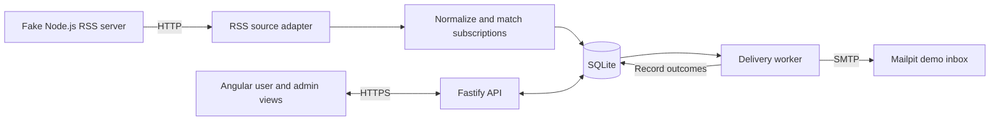

# Phase 1 World Event Alerts Design

The first milestone is a working demo that turns a new headline from the fake RSS server into a real SMTP email. A user creates a topic subscription in Angular, an administrator configures the feed and its polling interval, and the Node.js service fetches new items and sends matching alerts. SQLite keeps the settings, polling checkpoints, and delivery jobs. Slack and additional event sources are follow-up milestones.

[Assignment brief](P0-task-04-feature-design-and-build.docx) · [Prompt history](task-04-prompt-history.md)

## Scope and product decisions

| Area | Phase 1 decision | Reason and tradeoff |
| --- | --- | --- |
| Users | Start with provisioned user and admin accounts. Users can create, edit, pause, resume, and remove their own topic subscriptions. | Exercises account separation and the alert workflow. Self-service registration and account recovery are follow-up work. |
| Importance | An eligible news item matches an active subscription to its topic across enabled feeds. | A topic match is predictable and testable. Editorial urgency can be a separate rule when a source provides it. |
| Sources | The fake Node.js RSS server supplies the demo through the real RSS adapter. Admins can configure multiple feed URLs, and the demo uses one fake feed. | An independent source and real HTTP polling demonstrate the integration without provider credentials or published content. |
| Destinations | Send email to the user's provisioned address through Nodemailer and SMTP. Use Mailpit as the demo inbox. | Reviewers can inspect the received email without an external account or credentials. |
| Administration | Admins manage RSS URLs, topics, enabled status, and polling intervals. They can also view source health, last attempts and successful polls, and delivery outcomes. | Feed configuration is shared across the application. Poll status and email job history provide enough evidence for the demo. |
| Polling and recovery | Configure the demo feed to poll once a minute. Establish a fresh checkpoint on the first successful poll after adding or re-enabling a feed. If a feed stays enabled during a server outage, replay every eligible item since the saved checkpoint. | A fresh baseline skips items already in the feed. Outage recovery has no age cutoff. |

The assignment brief calls for email, Slack, additional event categories, extensibility, and an admin view. This demo covers email, RSS news, and the admin workflow. Slack, public news feeds, earthquakes, and market data remain follow-up integrations. The architecture provides a boundary for each adapter so later integrations can reuse the scheduler, subscription matching, and delivery worker.

## Architecture

Use one Node.js application with an HTTP API, source scheduler, and delivery worker loop. Run the fake RSS server locally and Mailpit in Docker. The standalone Mailpit executable is an alternative. Angular uses standalone components, Angular Router, HttpClient, and Signal Forms for new forms. Give users a subscription page and admins a feed and delivery dashboard. The API enforces ownership and admin authorization. [Mailpit Docker setup](https://mailpit.axllent.org/docs/install/docker/), [Angular Signal Forms](https://angular.dev/guide/forms/signals/comparison)

| Module | Responsibility |
| --- | --- |
| Accounts and settings | Manage users, roles, JWT sign-in, and provisioned email destinations. |
| Subscriptions | Manage topic rules and active or paused state. Match typed events against those rules. |
| Event sources | Own provider requests and credentials, payload validation, source checkpoints, and conversion to common events. |
| Ingestion | Evaluate new events in memory. Save the feed checkpoint and any resulting email jobs in one transaction. |
| Notification delivery | Resolve the registered adapter by channel, format alerts, send them, and record outcomes and retries. Adapters receive an authorized destination and a channel-neutral alert. |
| Admin | Manage RSS feed configuration through protected API routes and inspect poll status and delivery records. |

A normalized event has a source ID, provider event ID, event type, occurrence time, title, and source link when available. The demo adds typed news details such as topic and publisher. Subscriptions hold the rules, and the email destination comes from the account. Source adapters have no account access, and delivery adapters have no dependency on source payloads or subscription rules.

Register the RSS source adapter with the scheduler and the SMTP adapter with the delivery worker at startup. Keep the contracts small and verify them with test doubles. A future source that emits news uses the existing rules. A new event type adds its own fields and matcher. Slack can register a second channel adapter that validates a destination, formats the common alert, and posts it over HTTPS. It can reuse the existing delivery job lifecycle.

Keep one delivery job per source, item ID, channel, and destination so overlapping subscriptions to the same email address do not create duplicate messages. Save each job with its retry state, attempt count, and latest error. Before sending or retrying, check whether the recipient currently has an active subscription to the item's topic and whether the item was published after that subscription's activation. A provider call already in progress can finish after a pause. SQLite has no RSS article archive or per-item seen history.

Keep network calls outside database transactions. Retry transient failures with bounded backoff and surface permanent failures in admin. A timeout or crash after SMTP acceptance can still cause a duplicate on retry. The demo shows acceptance by recording a successful send in the app and displaying the email in Mailpit.

## Event source options

| Type | Candidate and integration | Considerations |
| --- | --- | --- |
| Earthquakes | **USGS GeoJSON** is a follow-up candidate. Poll an overlapping time window and map the feature ID, occurrence time, update time, and magnitude. [USGS feed documentation](https://earthquake.usgs.gov/earthquakes/feed/v1.0/geojson.php) | The public past-day feed updates every minute. A fixed provider ID allows revised magnitudes to update the existing event. |
| Other hazards | **National Weather Service API** for US weather alerts and **GDACS RSS or API** for more global hazards. [NWS API](https://www.weather.gov/documentation/services-web-api), [GDACS feed reference](https://www.gdacs.org/feed_reference.aspx) | Map severity, geography, updates, and cancellations per provider. Two providers reporting the same incident can create separate alerts until a correlation rule is established. |
| News | Poll each enabled **RSS** URL once per configured interval for the whole application. Users subscribe to the configured topics. [RSS 2.0 specification](https://www.rssboard.org/rss-specification) | Publisher coverage and update cadence determine what users get and how quickly. Adding subscribers does not increase feed requests. |
| Market data | For a later live adapter, evaluate polling **Alpha Vantage** for completed five-minute bars. [Alpha Vantage API](https://www.alphavantage.co/documentation/#intraday) | Check feed entitlements, quotas, market hours, latency, and redistribution rights. |
| Provider-defined triggers | **TradingView** can push prepared observations over HTTP POST when a configured alert fires. [TradingView webhook setup](https://www.tradingview.com/support/solutions/43000529348-how-to-configure-webhook-alerts/) | Push avoids polling and ties each trigger to provider-side setup. Confirm endpoint authentication and retry behavior before adopting it. |

To add a source, register an adapter, define how it polls or receives events, and map its payload to a common event. Give the adapter its own timeout, backoff, checkpoint, and test fixtures so other sources can continue when it fails. Verify that the provider can replay events since the saved checkpoint before relying on it for complete recovery. A feed that exposes only the latest items can lose history during a long outage. A new provider for an existing event type reuses the existing rules. A new event type adds typed fields and a matching rule. To add a channel, register an adapter for destination validation, message formatting, and sending, with no change to source ingestion or matching.

## News feed integration

Admins add, edit, and disable feeds in the admin view. Store each feed's source ID, URL, publisher label, topic, enabled status, and polling interval in SQLite. Require unique normalized URLs and admin authorization for configuration changes. The local demo accepts only the trusted fixture URLs configured for that run. When enabling public feeds later, require HTTPS, validate destinations, and confirm that the publisher's terms permit forwarding headlines. [NASA RSS feeds](https://www.nasa.gov/rss-feeds/), [Guardian RSS guidance](https://www.theguardian.com/help/feeds)

One application scheduler checks which enabled feeds are due and runs one polling cycle per feed, shared by all subscribers. A cycle may fetch multiple pages when recovering missed items. Request volume depends on the enabled feeds, their intervals, and the amount of history to recover. The default interval is five minutes per feed, with one minute for the demo feed. Admin edits apply to the next scheduled poll without restarting the service. Use Node fetch with timeouts and back off after failures. Evaluate **Feedsmith** in Phase 2 for typed RSS parsing. Public feeds can add conditional requests and publisher cache rules when integrated. If the API later runs on multiple replicas, keep one dedicated scheduler or coordinate feed claims in shared storage. [Feedsmith parser API](https://feedsmith.dev/parsing)

Persist the last poll attempt, last successful poll, and next due time per feed so the scheduler can resume after a restart. Keep a single item checkpoint per feed with the latest processed publication timestamp. The poll timestamps record when the application checked the feed. The item timestamp tells it which news is new. Update the last successful poll time when the cycle finishes. A failed fetch or import leaves the checkpoint at the last committed batch. Replacing a feed URL or re-enabling an intentionally disabled feed resets its baseline. Changing the interval retains the checkpoint. Discard in-flight results from before a feed was disabled or its URL replaced, even if the same URL is enabled again before the request returns.

On the first successful poll after adding or re-enabling a feed, save only the newest valid publication timestamp and send no alerts. If the feed is empty, record that initialization succeeded and leave the item checkpoint unset. On later polls, process every item newer than the checkpoint, oldest first. Commit each batch's email jobs and the checkpoint together, then continue until caught up. Advance the checkpoint even when no subscription matches. If a batch fails, resume from the last committed checkpoint. Discard unmatched entries after processing.

Save an activation time when a subscription is created or resumed. An eligible item must have been published after that time and match the subscription's active topic. Users whose subscriptions remained active receive all their missed items. Users who subscribe or resume during catch-up receive only items published after that activation.

The fake feed has one item per UTC minute, so the publication timestamp alone is sufficient. Repeated items and older arrivals are skipped. A future source that can publish several items at the same timestamp or reorder entries needs its own stable cursor or tie-break rule. RSS allows missing publication dates, so check that behavior before adding a public feed. [RSS item fields](https://www.rssboard.org/rss-specification#hrelementsOfLtitemgt)

| Alternative | When to use it |
| --- | --- |
| Atom feeds | The same fetching and matching pipeline can accept Atom when a publisher uses it. Map entry IDs, alternate links, and publication times to the same news event. [Atom format](https://www.rfc-editor.org/rfc/rfc4287) |
| Publisher API | The **Guardian Open Platform** offers structured topics and search from one publisher. Use it when RSS sections are too broad. It requires a key and a suitable access tier. [Guardian Open Platform](https://open-platform.theguardian.com/access/) |
| Multi-publisher API | **NewsAPI Top Headlines** offers broader coverage and filters by country, category, or source. Review latency, costs, and content rights. Its Developer plan is for development and testing only. [Top Headlines endpoint](https://newsapi.org/docs/endpoints/top-headlines), [NewsAPI plan terms](https://newsapi.org/pricing) |
| HTTP push | **WebSub** can reduce polling delay when the publisher's feed advertises a compatible hub. It adds a public HTTPS callback and subscription management. [W3C WebSub](https://www.w3.org/TR/websub/) |

A feed item is a published headline or announcement. Use a publisher-curated top-headlines source if users need editorial urgency. The default is a topic match.

### Fake RSS server for the demo and tests

Build a small Node.js server in Phase 2 that exposes a local RSS 2.0 endpoint at `/rss.xml` for development and end-to-end tests. Generate one synthetic item per UTC minute. The title and description use the exact format `News 2026-11-23T09:02:00.000Z`, with the timestamp rounded down to the minute. Use that minute as the item's stable GUID with `isPermaLink="false"` and include a valid RSS publication date.

The fixture derives items from UTC minutes, so it can reconstruct missed items without storing article history. Keep the ordinary RSS response small and provide a fixture-specific way to request items after a checkpoint in chronological pages. Each catch-up cycle reads through the latest item available when it starts and continues across as many pages as needed. This keeps page sizes bounded without limiting how far back the service can recover. Use the system clock for manual testing and a controllable clock for automated tests. Route the real RSS adapter to the fixture through test configuration so production feed validation still applies to admin-provided URLs.

In the end-to-end test, poll once to establish the baseline, advance the clock by one minute, then check that matching subscriptions receive the exact new headline. Poll the same minute again to verify that the adapter does not create duplicate deliveries. Simulate a restart after enough missed items to span multiple pages. Verify that a continuously active subscriber receives every item, while a newly activated subscriber only receives items published after activation.

## Email delivery and Slack follow-up

| Use | Choice and alternatives |
| --- | --- |
| Demo email | Use **Nodemailer over SMTP**. Run **Mailpit** locally through Docker to receive messages for the reviewer and provide an API for automated checks. A separately configured SMTP relay can handle external mail later. [Nodemailer](https://nodemailer.com/smtp), [Mailpit Docker setup](https://mailpit.axllent.org/docs/install/docker/) |
| Later Slack adapter | Evaluate **Incoming Webhooks** over HTTPS with server-side destination aliases. Each webhook posts to its configured channel. Use **chat.postMessage** if authorized channel selection or direct messages become requirements. [Slack Incoming Webhooks](https://docs.slack.dev/messaging/sending-messages-using-incoming-webhooks/), [Slack message posting](https://docs.slack.dev/reference/methods/chat.postMessage/) |

The delivery worker runs independently of the browser. The user and admin views read saved status through HTTP. No current component requires WebSockets.

## Stack decisions and feasibility

| Decision | Evidence and tradeoff |
| --- | --- |
| Angular 22 and Node.js 24 LTS | Angular lists Node 24 from 24.15.0 and TypeScript 6.0.x for Angular 22. The local runtime reported Node 24.22.1 and pnpm 11.25.0. Recheck compatibility at scaffolding and pin dependencies in Phase 2. [Angular compatibility](https://angular.dev/reference/versions), [Node releases](https://nodejs.org/en/about/previous-releases) |
| Fastify 5 with TypeScript | Fastify 5 supports Node 20 and newer. Route schemas provide input validation and response serialization with a small HTTP API. [Fastify 5 migration guide](https://fastify.dev/docs/v5.6.x/Guides/Migration-Guide-V5/), [Fastify validation](https://fastify.dev/docs/latest/Reference/Validation-and-Serialization/) |
| SQLite through node:sqlite | Use embedded storage and short transactions. A local in-memory check on Node 24.22.1 reported SQLite 3.53.4 and passed rollback, unique-key, and foreign-key assertions. Node's v24 docs mark the binding release candidate, so isolate it in the storage module. **better-sqlite3** is an alternative with a native package. Revisit PostgreSQL if multiple app instances or sustained parallel writes become necessary. [Node SQLite](https://github.com/nodejs/node/blob/v24.x/doc/api/sqlite.md), [better-sqlite3](https://github.com/WiseLibs/better-sqlite3), [SQLite concurrency](https://sqlite.org/wal.html#concurrency) |
| Future USGS contract | The [4.5+ past-day feed response](https://earthquake.usgs.gov/earthquakes/feed/v1.0/summary/4.5_day.geojson) contained a feature ID, magnitude, occurrence time, update time, source URL, and coordinates. Keep this check as evidence for the follow-up adapter. |

Checks performed on 23 November 2026 covered documentation compatibility, the local SQLite capabilities, and the public USGS response shape. Phase 2 should prove that the application fetches fake RSS over HTTP, saves a checkpoint and delivery job, and sends an SMTP message that appears in Mailpit. Verify restart, SMTP failure handling, feed startup, interval changes, repeated items, and catch-up when multiple items are newer than the checkpoint.

SQLite supplies the transaction and uniqueness constraints for the demo. The fixture provides a publication date and stable ID on every entry. Test malformed entries separately. They cannot become jobs or advance the checkpoint.

## Acceptance criteria

1. A user can create, edit, pause, resume, and remove their own topic subscription. The email destination defaults to their provisioned address. Settings and activation times survive restart. A regular user is denied access to another user's subscriptions and admin APIs.
2. A new fake RSS item triggers active subscriptions for its topic when published after their latest activation. The first poll stores only the newest valid timestamp, creating no news records or email jobs. Unrelated items, paused subscriptions, and items published before or at activation produce no jobs. Repeated fetches and overlapping subscriptions produce one job per event and email destination.
3. With the app closed in the user's browser, a matching alert reaches the SMTP inbox for the provisioned recipient. The received message includes the exact synthetic headline, topic, and source label. The admin view shows its delivery result.
4. Pending jobs survive restart. Transient failures retry within the configured limit and permanent failures are visible. Administrators can inspect source health and each job's attempt count and latest error. Credentials stay server-side.
5. Test doubles verify that source input and delivery are replaceable at the adapter boundaries. Unit and end-to-end tests cover supported workflows and failure cases using deterministic inputs.
6. An admin can add, disable, and re-enable feeds and change each feed's interval. A duplicate URL and configuration changes from regular users are rejected. Multiple subscriptions share one polling cycle for that URL. Re-enabling starts a fresh baseline with no backlog alerts. A server outage preserves the checkpoint for feeds that remain enabled, so the app processes every eligible missed item on recovery. A failed batch leaves the last committed checkpoint intact, so retry neither skips items nor duplicates their jobs.
7. The fake RSS endpoint produces one item per UTC minute with the expected headline and a stable GUID. An end-to-end test advances the fixture and scheduler clocks, verifies delivery of the new headline, and verifies that a repeated fetch produces no duplicate.

## Deliverables and order

| Phase | Deliverables and rationale | 24-hour planning budget |
| --- | --- | --- |
| P1 Define and plan | Scope, architecture, options, acceptance criteria, feasibility evidence, and prompt history. Set the target before investing in integrations. | 3 hours |
| P2 Prepare | Task breakdown, API and data specifications, skill discovery and installation, and a proof of concept that polls the fake Node.js RSS server and sends email to Mailpit. | 4 hours |
| P3 Implement | Runnable fake RSS and email demo, subscription and admin views, persisted jobs, and delivery diagnostics. Add unit and end-to-end coverage and run AI code review. | 11 hours |
| P4 Verify and review | Full test suites, fixes with regression tests, review evidence, and screenshots of changed UI elements. Record findings and any human review changes. | 4 hours |
| P5 Deliver | Local startup and walkthrough instructions for the app, fake feed, and inbox. Record known limits, follow-up integrations, and the repository and milestone history required for submission. | 2 hours |

The reviewer walkthrough is to start the local services, add the fake feed with a one-minute interval in admin, create a matching subscription, and watch the next headline arrive in Mailpit. The admin delivery entry and screenshots of the changed screens go in the review evidence. Keep the prompt history and decision record current so reviewers can see what was tested, what was rejected, and why.
