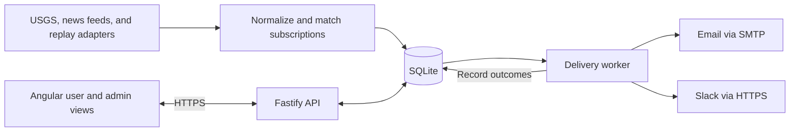

# Phase 1 World Event Alerts Design

Users should be able to choose which events matter to them and receive alerts through email, Slack, or both. Administrators should be able to see whether sources and deliveries are working. The first release uses an Angular web app, one TypeScript Node.js service, and SQLite. Event sources, subscription rules, and delivery channels can evolve independently.

[Assignment brief](P0-task-04-feature-design-and-build.docx) · [Prompt history](task-04-prompt-history.md)

## Scope and product decisions

| Area | Phase 1 decision | Reason and tradeoff |
| --- | --- | --- |
| Users | Start with provisioned user and admin accounts. Users can create, edit, pause, resume, and remove their own subscriptions, choose destinations, and view recent alert status. | Exercises access control and the core workflow. Self-service registration, recovery, and organization management can follow. |
| Importance | Each subscription selects an event type and a rule. Earthquakes use a minimum magnitude. News uses a publisher topic. Market movement uses a symbol and a minimum absolute percentage change between consecutive completed five-minute bars. Thresholds are inclusive. | Matching is predictable and testable. A news topic match carries no claim of editorial urgency. Each completed market interval can generate a new alert. |
| Sources | Poll USGS for earthquakes of magnitude 4.5 and above. Start with one admin-configured RSS feed and allow admins to add more. Keep market events as clearly labeled replay samples. | Demonstrates distinct source adapters without credentials for a market feed. Live news depends on confirming a feed's terms for the intended delivery. |
| Destinations | Email goes to the account's provisioned address. Slack users choose an allowed, named channel in one preconfigured workspace. A subscription can select either or both. | Supports real delivery with authorized credentials. Self-service Slack installation and direct messages require additional onboarding and permissions. |
| Administration | Admins manage RSS URLs, topics, enabled status, and polling intervals. They can also view source health, last attempts and successful polls, recent events, and delivery outcomes. | Feed configuration is shared across the application. Operational history helps distinguish source failures, missing matches, and send failures. |
| Speed and freshness | Poll USGS once a minute. Use a bounded catch-up window and backoff on failure. Initialize a checkpoint on first run to avoid alerting on the previous day's events. | The provisional target is queueing within two minutes of a qualifying event becoming visible in a healthy USGS feed. Measure this and set the freshness cutoff in Phase 2. |

The design assumes one deployment, one Slack workspace, and low event volume. Alerts are informational. If an RSS feed is unavailable or its terms do not cover the intended use, demonstrate the same adapter with synthetic RSS. A live market source can follow once access, terms, and latency are confirmed.

## Architecture

Use one Node.js deployment with an HTTP API, source scheduler, and delivery worker loop. Angular uses standalone components, Angular Router, HttpClient, and Signal Forms for new forms. Serve separate subscription, account settings, and admin routes. The API enforces ownership and admin authorization. [Angular Signal Forms](https://angular.dev/guide/forms/signals/comparison)

| Module | Responsibility |
| --- | --- |
| Accounts and settings | Manage users, roles, sessions, and authorized destination references. |
| Subscriptions | Manage saved rules, active or paused state, and selected destinations. Match typed events against those rules. |
| Event sources | Own provider requests and credentials, payload validation, source checkpoints, and conversion to common events. |
| Ingestion | Deduplicate, handle source revisions, and persist events, matches, and pending delivery jobs in one transaction. |
| Notification delivery | Resolve the registered adapter by channel, format alerts, send them, and record outcomes and retries. Adapters receive an authorized destination and a channel-neutral alert. |
| Admin | Manage RSS feed configuration through protected API routes and inspect source, event, match, and delivery records. |

A normalized event has a source ID, provider event ID, event type, occurrence time, provider update time when available, title, and source link when available. Typed details hold earthquake magnitude, news topic, or a market symbol and percentage change. A market adapter can emit one observation per symbol and completed interval with a deterministic ID. User thresholds and destination selections stay with subscriptions. Source adapters have no account access, and delivery adapters have no dependency on source payloads or subscription rules.

Deduplicate repeated polls using the source and provider event ID. Apply newer revisions so a qualifying correction can trigger a first alert while the event is still eligible. Keep one delivery job per event and destination so overlapping subscriptions to the same channel do not post duplicates. Record which subscriptions matched. Before sending a queued job, check that at least one matching subscription still enables that destination. A provider call already in progress can finish after a pause.

Keep network calls outside database transactions. Retry transient failures with bounded backoff, honor provider rate limits, and surface permanent failures in admin. A timeout or crash after provider acceptance can still cause a duplicate on retry. The initial success state means provider acceptance. [Slack API rate limits](https://docs.slack.dev/apis/web-api/rate-limits/)

## Event source options

| Type | Candidate and integration | Considerations |
| --- | --- | --- |
| Earthquakes | **USGS GeoJSON**, the first live adapter. Poll an overlapping time window and map the feature ID, occurrence time, update time, and magnitude. [USGS feed documentation](https://earthquake.usgs.gov/earthquakes/feed/v1.0/geojson.php) | The public past-day feed updates every minute. A fixed provider ID allows revised magnitudes to update the existing event. |
| Other hazards | **National Weather Service API** for US weather alerts and **GDACS RSS or API** for more global hazards. [NWS API](https://www.weather.gov/documentation/services-web-api), [GDACS feed reference](https://www.gdacs.org/feed_reference.aspx) | Map severity, geography, updates, and cancellations per provider. Two providers reporting the same incident can create separate alerts until a correlation rule is established. |
| News | Poll each enabled **RSS** URL once per configured interval for the whole application. Users subscribe to the configured topics. [RSS 2.0 specification](https://www.rssboard.org/rss-specification) | Publisher coverage and update cadence determine what users get and how quickly. Adding subscribers does not increase feed requests. |
| Market data | Replay sample events first. For live data, evaluate polling **Alpha Vantage** for completed five-minute bars. [Alpha Vantage API](https://www.alphavantage.co/documentation/#intraday) | Check feed entitlements, quotas, market hours, latency, and redistribution rights. |
| Provider-defined triggers | **TradingView** can push prepared observations over HTTP POST when a configured alert fires. [TradingView webhook setup](https://www.tradingview.com/support/solutions/43000529348-how-to-configure-webhook-alerts/) | Push avoids polling and ties each trigger to provider-side setup. Confirm endpoint authentication and retry behavior before adopting it. |

To add a source, register an adapter, define how it polls or receives events, and map its payload to a common event. Give the adapter its own timeout, backoff, checkpoint, and test fixtures so other sources can continue when it fails. A new provider for an existing event type reuses the existing rules. A new event type adds typed fields and a matching rule. To add a channel, register an adapter for destination validation, message formatting, and sending, with no change to source ingestion or matching.

## News feed integration

Admins add, edit, and disable feeds in the admin view. Store each feed's source ID, HTTPS URL, publisher label, topic, enabled status, and polling interval in SQLite. Require unique normalized feed URLs, validate that the server fetches only public destinations, and enforce admin authorization on configuration changes. Users subscribe to topics. Start with an official section or announcements feed, such as NASA News Releases for science and space. The Guardian publishes section feeds for personal, noncommercial use under its terms. Confirm that a feed permits the intended Slack and email use before enabling it. Send plain-text headlines, publisher attribution, and links where permitted. [NASA RSS feeds](https://www.nasa.gov/rss-feeds/), [Guardian RSS guidance](https://www.theguardian.com/help/feeds)

One application scheduler checks which enabled feeds are due and allows one in-flight poll per feed. It fetches each due URL once, normalizes the entries, and passes new events to subscription matching. Request volume depends on the number of enabled feeds and their intervals. The default interval is five minutes per feed. Admin edits apply to the next scheduled poll without restarting the service. Respect publisher cache guidance and back off after failures. Use Node fetch with timeouts and conditional requests when a feed supplies an ETag or Last-Modified value. Evaluate **Feedsmith** in Phase 2 for typed RSS and Atom parsing. If the API later runs on multiple replicas, keep one dedicated scheduler or coordinate feed claims in shared storage. [Feedsmith parser API](https://feedsmith.dev/parsing)

Persist the last poll attempt, last successful poll, and next due time per feed so the scheduler can resume after a restart. A successful import commits the events and delivery jobs together with the feed checkpoint. An HTTP 304 updates the last successful poll without generating events. A failed fetch or import records the failure and keeps the previous successful checkpoint and HTTP validators. Replacing a feed URL starts a new checkpoint. Changing its interval retains the checkpoint. Discard results from a pending request if its URL has been replaced or the feed has been disabled before import.

On the first successful poll, record existing items as seen so enabling a feed does not send its backlog. On later polls, use the previous successful poll as the time reference for freshness and catch-up, and identify unseen items by feed ID and RSS GUID or Atom entry ID. Fall back to the normalized article URL when there is no ID. Check unseen items within the freshness window even if their publication time predates the last poll or equals another item's time. This handles late arrivals and avoids dropping items that share a timestamp. Keep first-seen time distinct from publication time when the date is missing. An edited headline with the same item ID stays one event. Different articles about the same story may each alert. [RSS item fields](https://www.rssboard.org/rss-specification#hrelementsOfLtitemgt), [Atom format](https://www.rfc-editor.org/rfc/rfc4287)

| Alternative | When to use it |
| --- | --- |
| Atom feeds | The same fetching and matching pipeline can accept Atom when a publisher uses it. Map entry IDs, alternate links, and publication times to the same news event. [Atom format](https://www.rfc-editor.org/rfc/rfc4287) |
| Publisher API | The **Guardian Open Platform** offers structured topics and search from one publisher. Use it when RSS sections are too broad. It requires a key and a suitable access tier. [Guardian Open Platform](https://open-platform.theguardian.com/access/) |
| Multi-publisher API | **NewsAPI Top Headlines** offers broader coverage and filters by country, category, or source. Review latency, costs, and content rights. Its Developer plan is for development and testing only. [Top Headlines endpoint](https://newsapi.org/docs/endpoints/top-headlines), [NewsAPI plan terms](https://newsapi.org/pricing) |
| HTTP push | **WebSub** can reduce polling delay when the publisher's feed advertises a compatible hub. It adds a public HTTPS callback and subscription management. [W3C WebSub](https://www.w3.org/TR/websub/) |

A feed item is a published headline or announcement. Use a publisher-curated top-headlines source if users need editorial urgency. The default is a topic match.

### Fake RSS server for tests

Build a small Node.js server in Phase 2 that exposes a local RSS 2.0 endpoint at `/rss.xml` for development and end-to-end tests. Generate one synthetic item per UTC minute. The title and description use the exact format `News 2026-11-23T09:02:00.000Z`, with the timestamp rounded down to the minute. Use that minute as the item's stable GUID with `isPermaLink="false"` and include a valid RSS publication date.

Return a bounded window of recent items wide enough to cover test polling intervals longer than one minute. Use the system clock for manual testing and a controllable clock for automated tests. Route the real RSS adapter to the fixture through test configuration so production feed validation still applies to admin-provided URLs.

In the end-to-end test, poll once to establish the baseline, advance the clock by one minute, then check that matching subscriptions receive the exact new headline. Poll the same minute again to verify that the adapter does not create duplicate deliveries.

## Email and Slack delivery

| Use | Choice and alternatives |
| --- | --- |
| Email | Use **Nodemailer over SMTP**. A configured relay handles external email. **Mailpit** captures local email for automated tests. **Resend** offers an HTTP API if provider-specific features become useful. [Nodemailer](https://nodemailer.com/smtp), [Mailpit](https://mailpit.axllent.org/docs/), [Resend send API](https://resend.com/docs/api-reference/emails/send-email) |
| Slack | Use **Incoming Webhooks** over HTTPS and keep URLs server-side behind destination aliases. Each webhook posts to its configured channel. Node fetch is enough for a POST. **@slack/webhook** is the official helper. **@slack/web-api** and **chat.postMessage** support choosing authorized conversation IDs with an installed app. [Slack Incoming Webhooks](https://docs.slack.dev/messaging/sending-messages-using-incoming-webhooks/), [Slack webhook SDK](https://docs.slack.dev/tools/node-slack-sdk/webhook/), [Slack message posting](https://docs.slack.dev/reference/methods/chat.postMessage/) |

The delivery worker runs independently of the browser. The user and admin views read saved status through HTTP. No current component requires WebSockets.

## Stack decisions and feasibility

| Decision | Evidence and tradeoff |
| --- | --- |
| Angular 22 and Node.js 24 LTS | Angular lists Node 24 from 24.15.0 and TypeScript 6.0.x for Angular 22. The local runtime reported Node 24.22.1 and pnpm 11.25.0. Recheck compatibility at scaffolding and pin dependencies in Phase 2. [Angular compatibility](https://angular.dev/reference/versions), [Node releases](https://nodejs.org/en/about/previous-releases) |
| Fastify 5 with TypeScript | Fastify 5 supports Node 20 and newer. Route schemas provide input validation and response serialization with a small HTTP API. [Fastify 5 migration guide](https://fastify.dev/docs/v5.6.x/Guides/Migration-Guide-V5/), [Fastify validation](https://fastify.dev/docs/latest/Reference/Validation-and-Serialization/) |
| SQLite through node:sqlite | Use embedded storage and short transactions. A local in-memory check on Node 24.22.1 reported SQLite 3.53.4 and passed rollback, unique-key, and foreign-key assertions. Node's v24 docs mark the binding release candidate, so isolate it in the storage module. **better-sqlite3** is an alternative with a native package. Revisit PostgreSQL if multiple app instances or sustained parallel writes become necessary. [Node SQLite](https://github.com/nodejs/node/blob/v24.x/doc/api/sqlite.md), [better-sqlite3](https://github.com/WiseLibs/better-sqlite3), [SQLite concurrency](https://sqlite.org/wal.html#concurrency) |
| USGS contract | The [4.5+ past-day feed response](https://earthquake.usgs.gov/earthquakes/feed/v1.0/summary/4.5_day.geojson) contained a feature ID, magnitude, occurrence time, update time, source URL, and coordinates. The wider lookback gives room for short outages, subject to the alert freshness cutoff. |

Checks performed on 23 November 2026 covered documentation compatibility, the local SQLite capabilities, and the public USGS response shape. Phase 2 should verify on-disk restart and job recovery, normalization against saved source data, SMTP delivery to Mailpit, and Slack success and retry handling against a local HTTP stub. Verify real email and Slack delivery using authorized test destinations when credentials are available.

The USGS response gives both occurrence and update times, so revisions can update an existing event without treating each poll as a new occurrence. SQLite supplies the transaction and uniqueness constraints this design needs, so a separate broker and database service can wait until there is evidence of a scaling need. The RSS specification allows items without a GUID or publication date, so the adapter needs URL and first-seen fallbacks. Phase 2 should verify the selected live feed and exercise startup, an interval change, restart, failures, and late or incomplete entries using saved or synthetic XML.

## Acceptance criteria

1. A user can create, edit, pause, resume, and remove their own subscription with a valid rule and at least one authorized destination. Settings survive restart. A regular user is denied access to another user's subscriptions and admin APIs.
2. An eligible USGS event, a new RSS item, and a representative replayed market event trigger matching subscriptions. Feed startup does not send existing headlines. Below-threshold, unrelated, paused, and stale cases produce no sends. Repeated ingestion produces one job per destination. A qualifying revision can produce the first job.
3. A matching alert can produce independent email and Slack messages with the browser closed. Each identifies the event, the relevant measurement or topic, and the source when available. A shared Slack message excludes personal subscription settings. One channel can fail while the other succeeds.
4. Pending jobs survive restart. Transient failures retry within the configured limit and permanent failures are visible. Administrators can inspect source health, event records, and delivery attempts. Credentials stay server-side.
5. A second source integrates through the same ingestion contract. A test delivery adapter plugs into the worker using the same matching logic. Unit and end-to-end tests cover supported workflows and failure cases using deterministic inputs.
6. An admin can add and disable feeds and change each feed's interval. A duplicate URL and configuration changes from regular users are rejected. Multiple subscriptions produce one fetch per scheduled poll of that URL. Restart retains the schedule and checkpoint. A failed poll leaves the last successful poll time intact, and the next successful poll can import previously unseen items.
7. The fake RSS endpoint produces one item per UTC minute with the expected headline and a stable GUID. An end-to-end test advances the fixture and scheduler clocks, verifies delivery of the new headline, and verifies that a repeated fetch produces no duplicate.

## Deliverables and order

| Phase | Deliverables and rationale | 24-hour planning budget |
| --- | --- | --- |
| P1 Define and plan | Scope, architecture, options, acceptance criteria, feasibility evidence, and prompt history. Set the target before investing in integrations. | 3 hours |
| P2 Prepare | Task breakdown, API and data specifications, proof of concept from ingestion through delivery with a fake Node.js RSS server, relevant skills, and verification plan. Validate persistence and provider boundaries first. | 4 hours |
| P3 Implement | Runnable app, first sources, both notification channels, and user and admin views. Work through one complete workflow first, then add unit and end-to-end coverage and run AI code review. | 11 hours |
| P4 Verify and review | Full test suites, fixes with regression tests, review evidence, and screenshots of changed UI elements. Record findings and any human review changes. | 4 hours |
| P5 Deliver | Setup and operation instructions, known limits, follow-up work, and the repository and milestone history required for submission. | 2 hours |

If time is tight, preserve the deterministic end-to-end demo, including RSS fixtures, both delivery paths, admin diagnostics, and verification evidence. Defer a live market source, extra news feeds, and Slack self-service. Keep the prompt history and decision record current so reviewers can see what was tested, what was rejected, and why.
