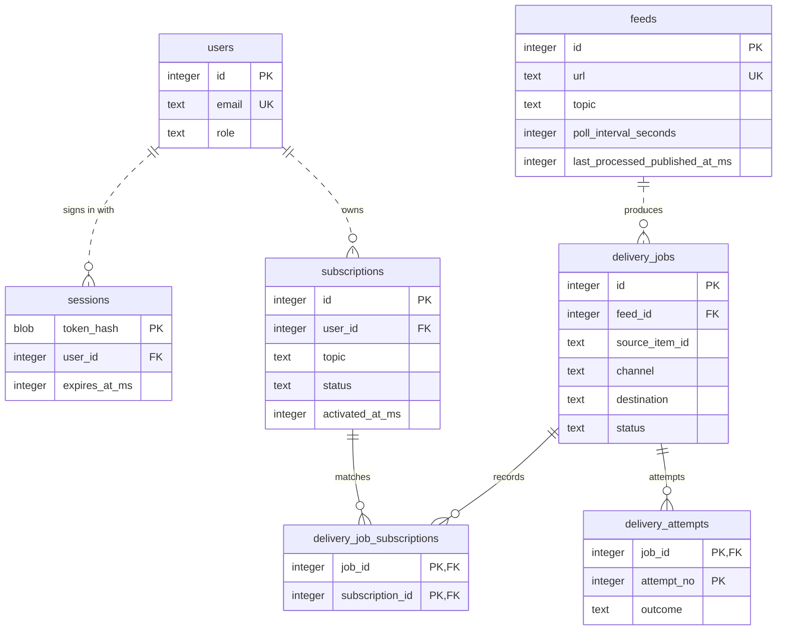

# Phase 2 Database Design for Review

The demo stores accounts, subscriptions, one progress checkpoint per feed, and email delivery history. The [SQLite schema](P2-task-04-demo-schema.sql) is a review draft for the Phase 3 migration.

## Table relationships

The diagram shows key fields. All columns, constraints, and indexes are in the SQL file. Solid lines indicate that the parent key is part of the child's primary key. A feed and a subscription match on the same topic value. One topic can be served by multiple feeds, so a subscription has no feed foreign key. The app derives available topics from enabled feeds.

| Table | What it keeps |
| --- | --- |
| `users` | The provisioned email address, password hash, and user or admin role. |
| `sessions` | A hash of the session token, its owner, and expiration. The raw token stays in the session cookie. |
| `subscriptions` | The owner's topic, status, and latest activation time. The recipient address comes from the owner. Removed subscriptions keep their IDs for delivery history. |
| `feeds` | Admin settings, the poll schedule and health, and the newest processed publication timestamp. The initialization marker distinguishes an empty first poll from a feed that has never been polled. |
| `delivery_jobs` | One message to send through a channel. It holds the title, topic, publisher, publication time, optional article link, destination, and retry state. |
| `delivery_job_subscriptions` | Which subscriptions matched a job. Several matching subscriptions can share one email. The worker checks these links against current subscription settings before sending. |
| `delivery_attempts` | Each send attempt's start, result, and completion time. The admin view can derive attempt counts and the latest failure from this history. |

## Rules to verify

- **One checkpoint per feed.** The first successful poll writes the checkpoint and creates no jobs. Later pages update the checkpoint in the same transaction as their delivery jobs. SQLite keeps no RSS article archive or per-item seen history.
- **One job per item and destination.** The unique key combines feed, source URL, item ID, channel, and destination. Including the source URL keeps two sources from colliding if an admin replaces the URL on a feed and both sources use the same item ID. The job keeps a snapshot of its source URL and publisher for review.
- **Eligibility starts at activation.** The app matches items published strictly after the latest activation time. It checks the topic, activation, and recipient again before sending queued jobs. Store timestamps as UTC Unix milliseconds.
- **Extensibility stays at the adapter boundary.** The demo uses an RSS source and an email channel. The feed kind and job channel identify the registered adapters. Destination validation and message formatting belong to the delivery adapter.

## Schema verification

Loaded the draft into an in-memory SQLite database. Its tables, columns, and foreign keys matched the diagram. A test transaction confirmed that rolling back a job insert also rolled back its feed checkpoint. SQLite accepted two subscription links for one job, rejected a duplicate delivery, and allowed the same item for another destination, channel, or source URL. The foreign-key and integrity checks passed.
