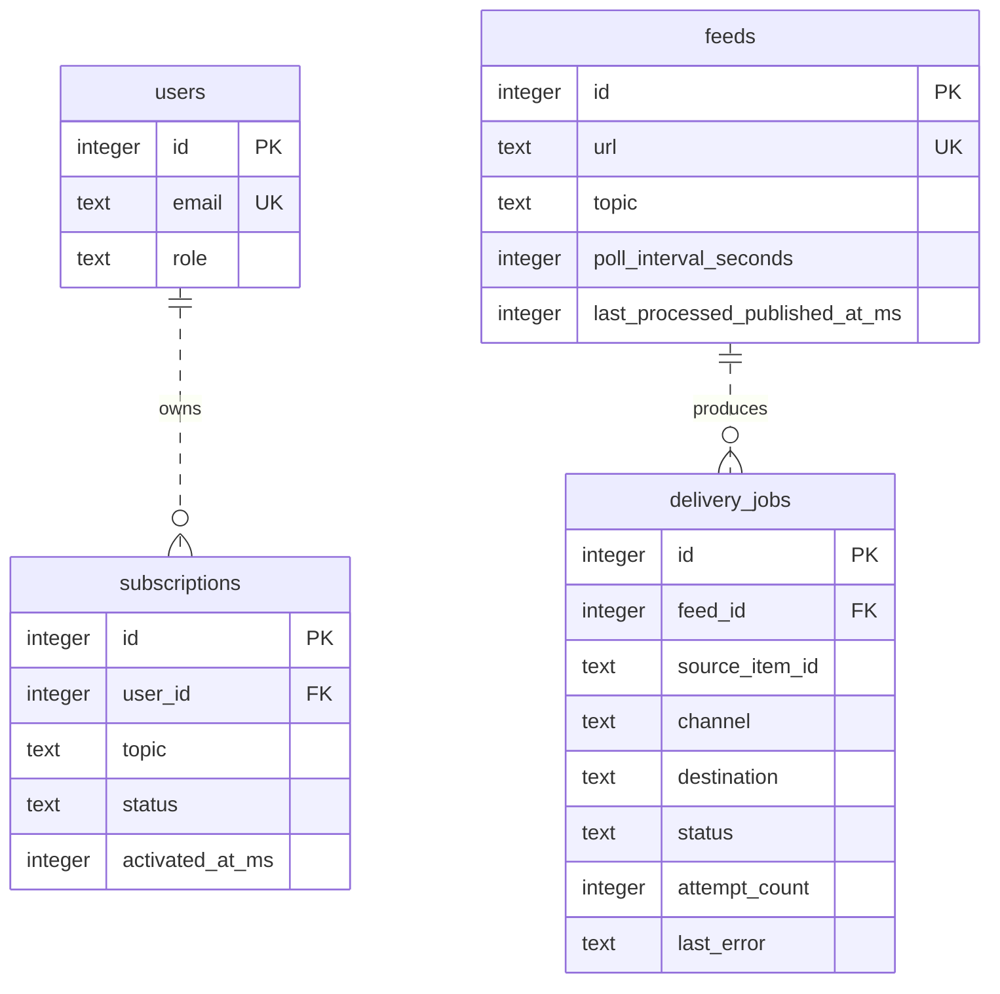

# Phase 2 Database Design for Review

The demo uses four tables for accounts, subscriptions, feeds, and delivery jobs. A feed stores its own progress checkpoint, and each job stores its retry summary. The [SQLite schema](P2-task-04-demo-schema.sql) is the draft for the Phase 3 migration.

## Table relationships

The diagram shows the stored foreign keys. The app matches subscriptions to all enabled feeds with the same topic and derives the available topics from those feeds. Login uses a signed, expiring JWT in an HTTP-only cookie. Logout clears the cookie, and a copied token stays valid until expiry.

| Table | What it keeps |
| --- | --- |
| `users` | The provisioned email address, password hash, and user or admin role. |
| `subscriptions` | The owner's topic, status, and latest activation time. The recipient address comes from the owner. Deleting a subscription removes its row. |
| `feeds` | Admin settings, the poll schedule and health, and the newest processed publication timestamp. The initialization marker distinguishes an empty first poll from a feed that has never been polled. |
| `delivery_jobs` | One message per item, channel, and destination. It keeps the alert payload, status, retry time, attempt count, and latest error. |

## Rules to verify

- **One checkpoint per feed.** The first successful poll after adding or re-enabling a feed writes the checkpoint and creates no jobs. Later pages update the checkpoint in the same transaction as their delivery jobs. SQLite keeps no RSS article archive or per-item seen history.
- **One job per item and destination.** The unique key combines feed, source URL, item ID, channel, and destination. Including the source URL keeps two sources from colliding if an admin replaces the URL on a feed and both sources use the same item ID. The job keeps a snapshot of its source URL and publisher for review.
- **Eligibility starts at activation.** The app matches items published strictly after the latest activation time. Before a send or retry, it looks up current subscriptions by the queued recipient and topic and checks the item's publication time. It cancels the job if none qualify. Store timestamps as UTC Unix milliseconds.
- **Extensibility stays at the adapter boundary.** The demo uses an RSS source and an email channel. The feed kind and job channel identify the registered adapters. Destination validation and message formatting belong to the delivery adapter.

## Schema verification

Loaded the four-table draft into SQLite. Verified that the diagram matches its foreign keys, checkpoint updates roll back with failed job writes, and duplicate jobs are rejected. A representative eligibility query checked overlapping subscriptions, topic matching across feeds, and pause, deletion, and activation cutoffs using current rows.
