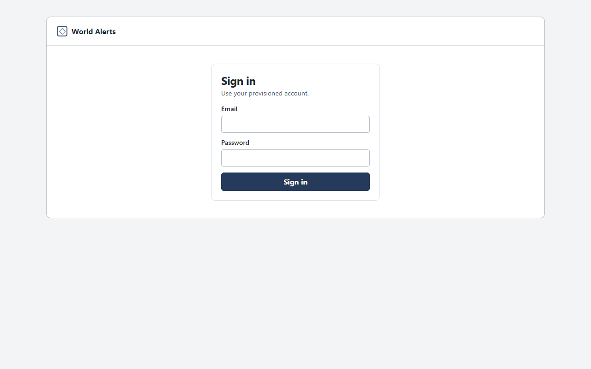
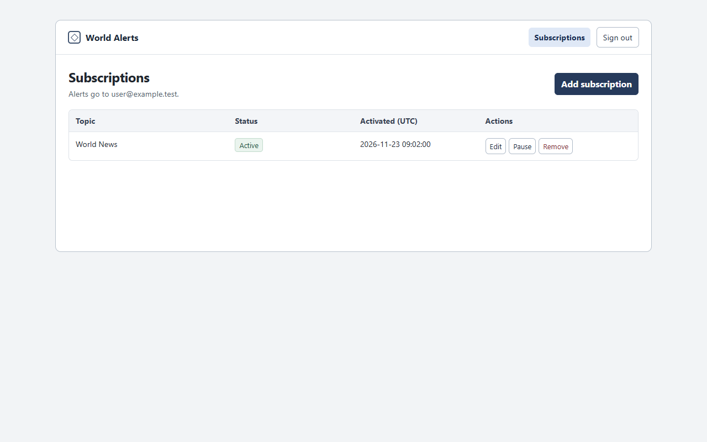
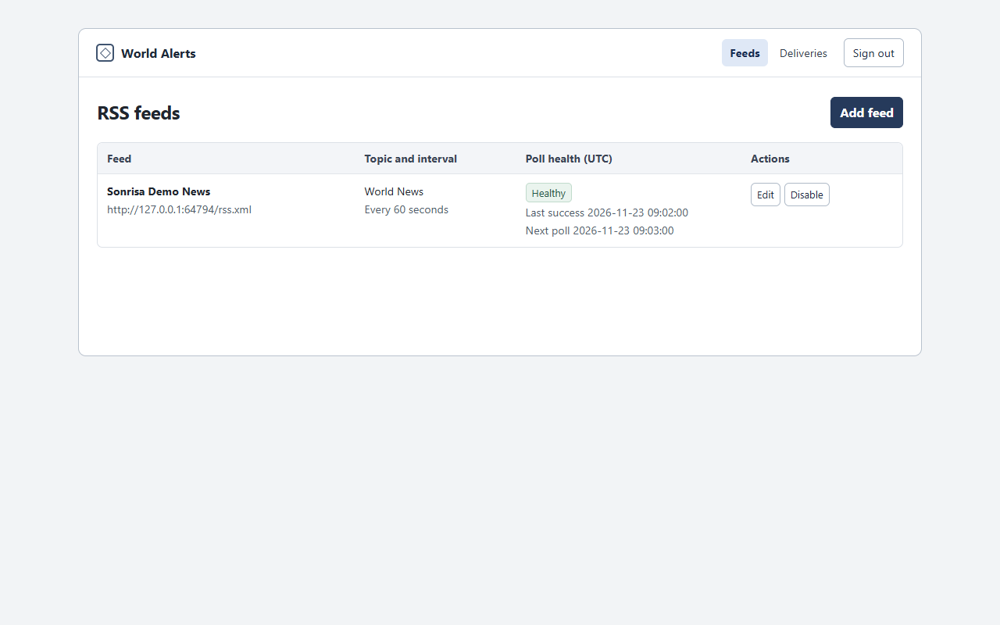
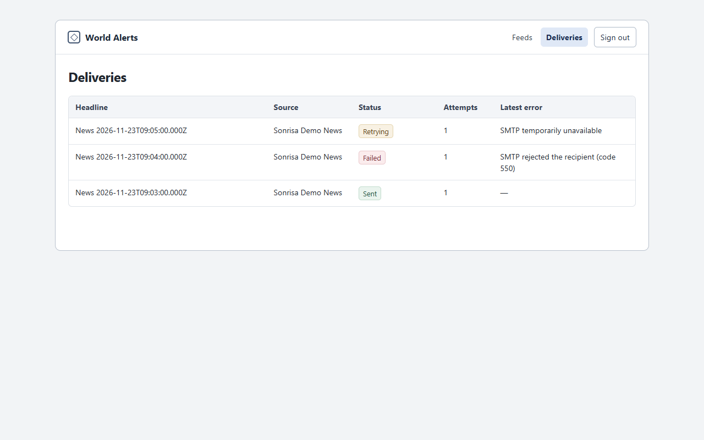
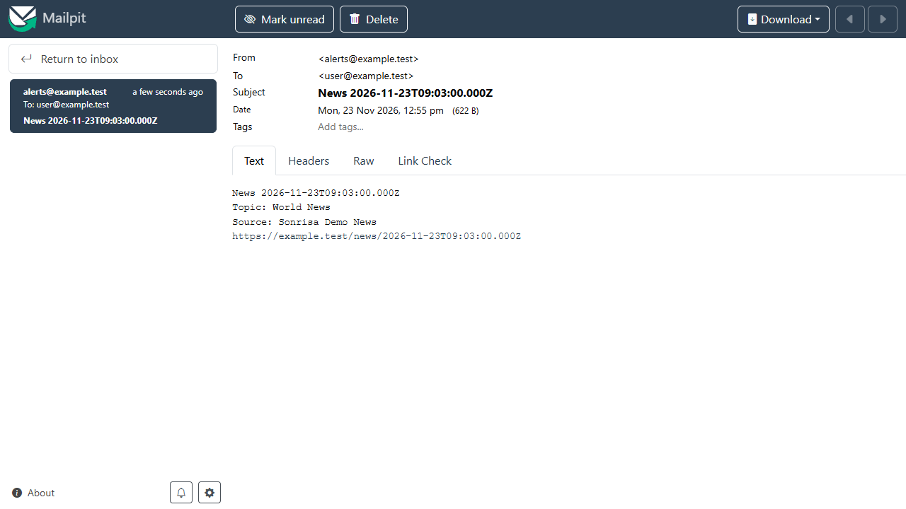

# Application review evidence

The screenshots show the built Angular application in Microsoft Edge with the Fastify API and synthetic accounts. All 10 Playwright end-to-end scenarios passed with the live Hungarian Google News check enabled. The image links below open the original PNGs.

The evidence run used a controlled clock for the synthetic news. The successful email went through SMTP to an isolated Mailpit inbox. Delayed requests, HTTP errors, and SMTP error responses were injected to capture failure states reliably. The Google News row shows a successful live poll of the public URL.

## Sign in and access

- [Invalid credentials](sign-in-invalid-credentials.png)
- [Expired session](sign-in-expired-session.png)
- [Access denied when a regular user opens an admin page](access-denied.png)

## Subscriptions

- [Mobile layout](subscriptions-mobile.png)
- [No subscriptions](subscriptions-empty.png)
- [No enabled topics](subscriptions-no-topics.png)
- [Loading](subscriptions-loading.png)
- [Load error and retry](subscriptions-load-error.png)
- [Add subscription dialog](subscriptions-add-dialog.png)
- [Edit subscription dialog](subscriptions-edit-dialog.png)
- [Remove subscription confirmation](subscriptions-remove-dialog.png)
- [Paused subscription](subscriptions-paused.png)

## Admin RSS feeds

- [No configured feeds](feeds-empty.png)
- [Loading](feeds-loading.png)
- [Load error and retry](feeds-load-error.png)
- [Add feed dialog](feeds-add-dialog.png)
- [Edit feed dialog](feeds-edit-dialog.png)
- [Duplicate URL validation](feeds-duplicate-url.png)
- [Waiting for the first poll](feeds-waiting.png)
- [Poll failed](feeds-poll-failed.png)
- [Disabled feed](feeds-disabled.png)
- [Hungarian Google News after a successful live poll](feeds-live-google-news.png)

## Admin deliveries

- [No deliveries](deliveries-empty.png)
- [Loading](deliveries-loading.png)
- [Load error and retry](deliveries-load-error.png)
- [First alert marked Sent](deliveries-sent.png)

## Email in Mailpit

The message to `user@example.test` shows the same headline as the first sent delivery, with its topic and source in the body.

