# Slack delivery review

The browser tests used a simulated Slack provider, a fake RSS feed, and real Mailpit email. They verified consent cancellation and retry, account linking, Email defaults, the required channel selection, combined delivery, Slack-only delivery, Slack throttling while Email stayed available, and the cutoff after reconnecting. The simulated Slack destination was `DDEMO`; the captured API request contained the same headline as the corresponding Mailpit email.

Backend verification covered the identity signature, nonce, workspace and token claims, account ownership, replay protection, migration, queue eligibility, and provider failure handling. The full verification run passed 62 backend tests, 21 Angular tests, and 15 Playwright tests, including live Google News and USGS checks. The Angular production build and Phase 2 proof-of-concept checks also passed.

The operator confirmed receiving a real DM from the installed bot after manually pairing the local demo user with their Slack member ID. Slack rejected the plain HTTP localhost redirect during authorization. The browser-based **Connect Slack** flow still needs live verification with an HTTPS callback. See the [live smoke-test steps](../../slack-alerts.md#verify-your-workspace).

## Before connecting Slack

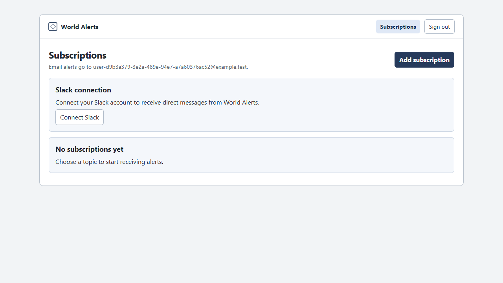

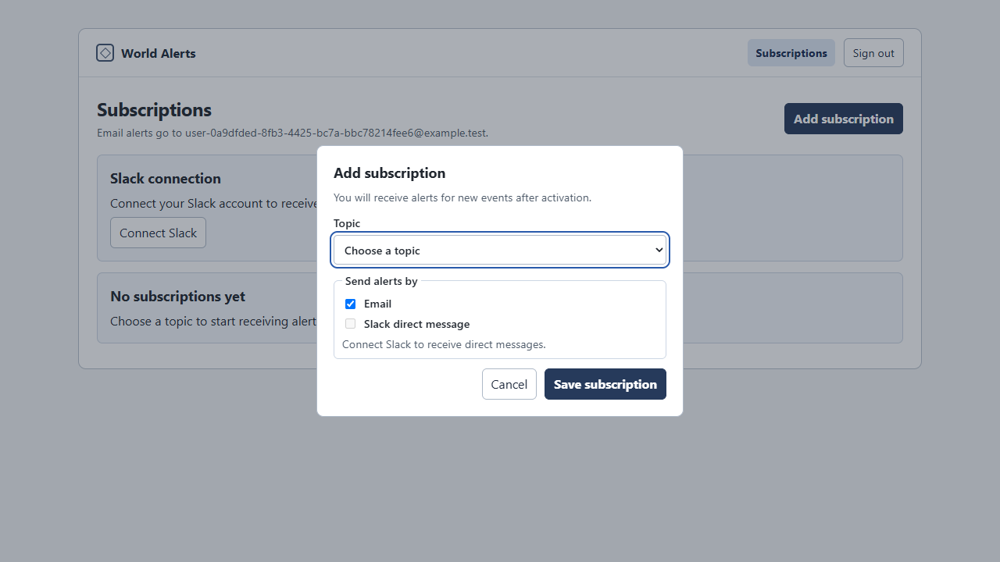

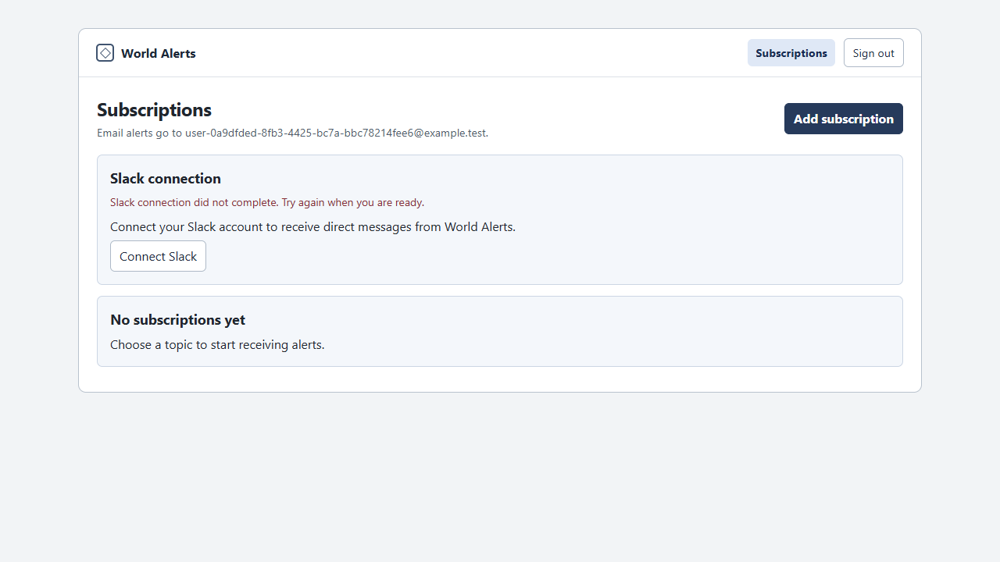

## Adding a subscription for both channels

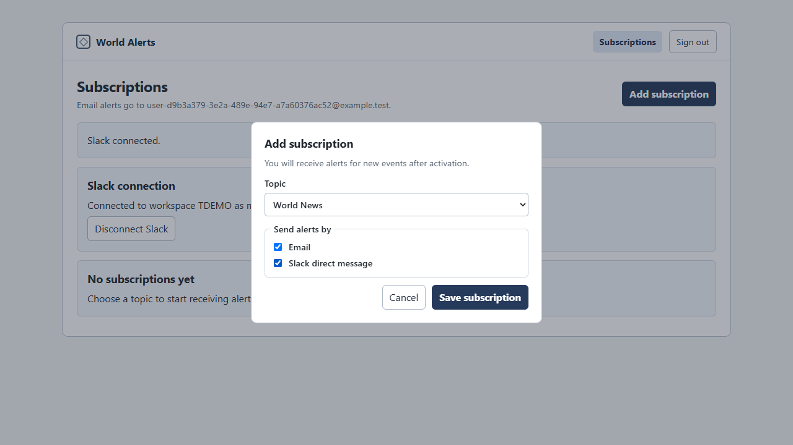

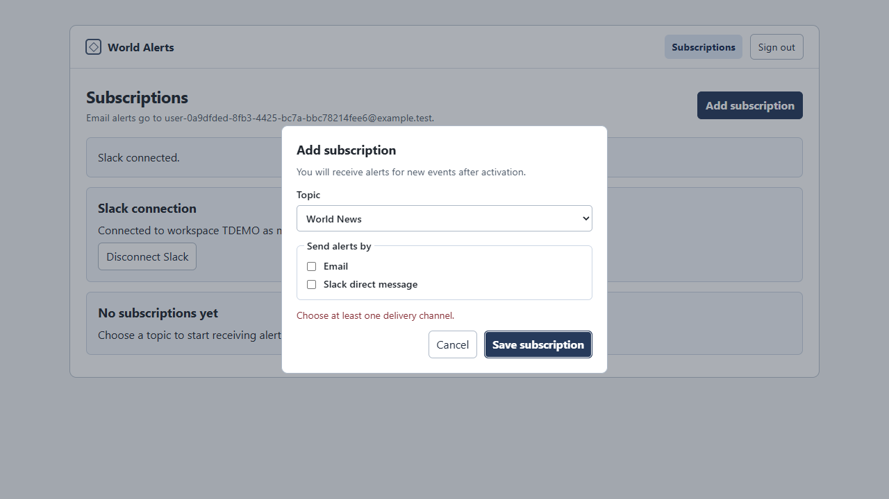

## Connected user with a saved subscription

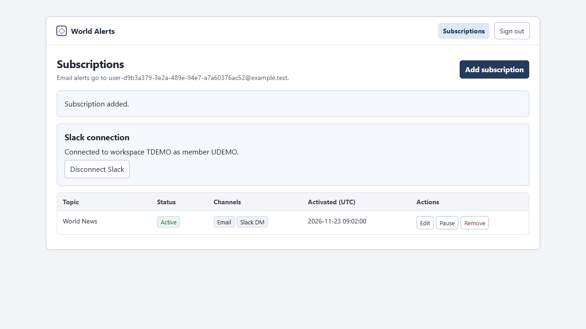

## Admin delivery while Slack is rate limited

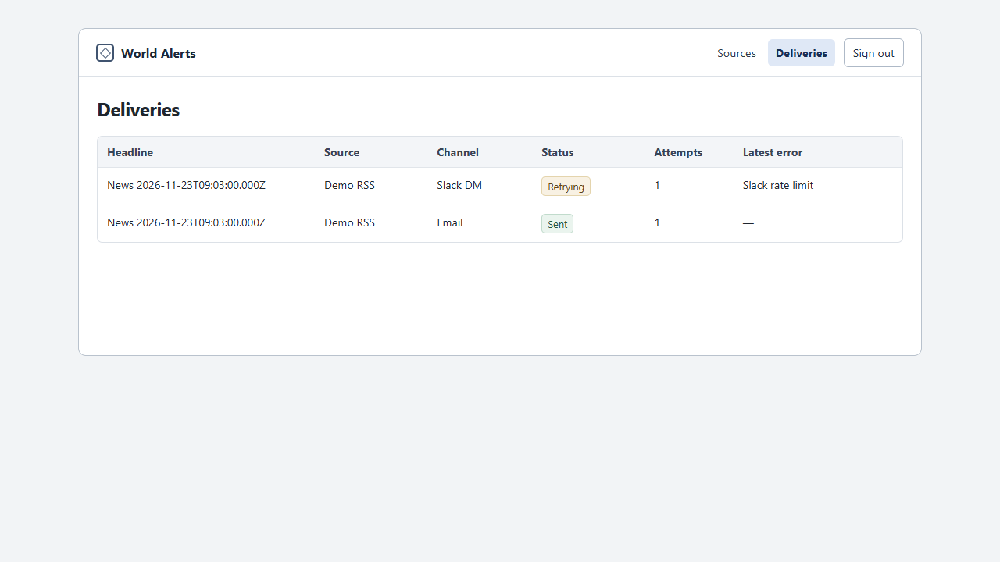

## Admin delivery after the Slack retry

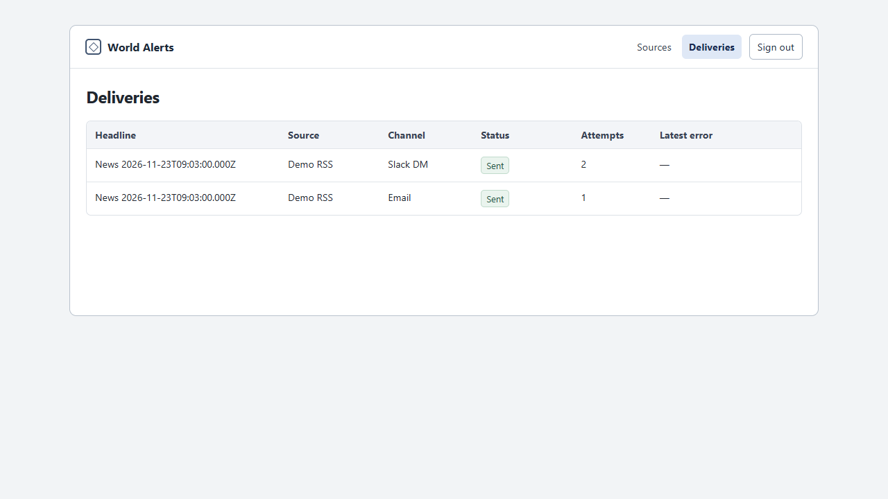

## Saved Slack preference after disconnecting

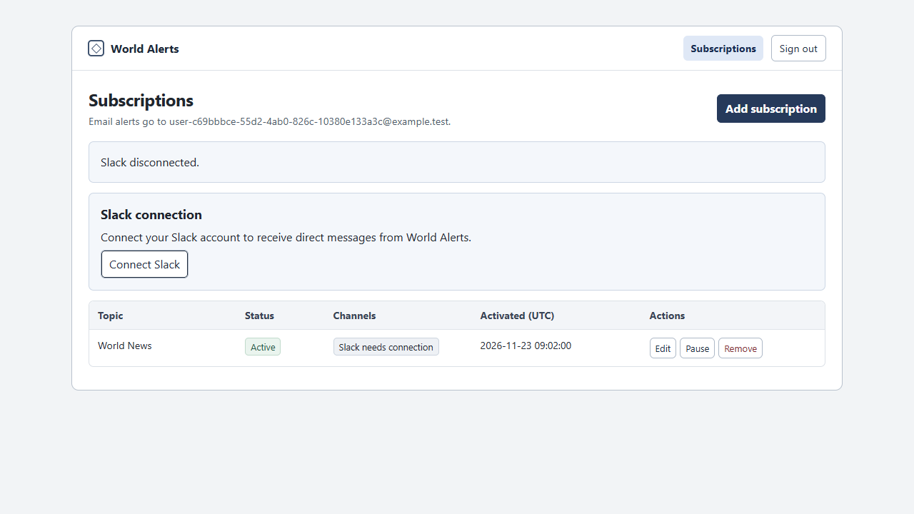

## Editing a Slack-only subscription

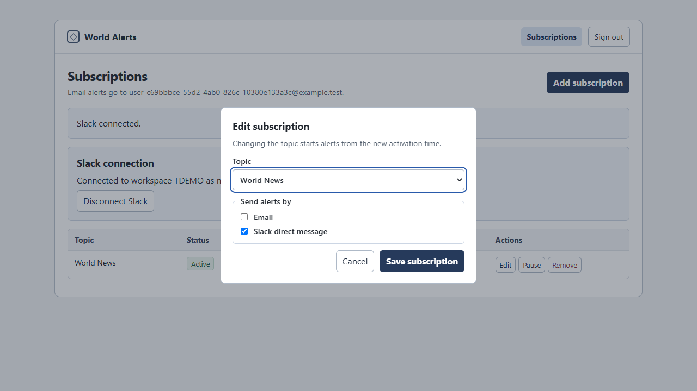

## Installation without Slack configured

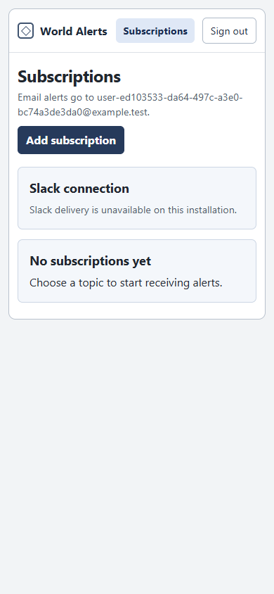

## Received Slack direct message

This is the received notification from the manual workspace test. The captured area contains the bot conversation and alert content.

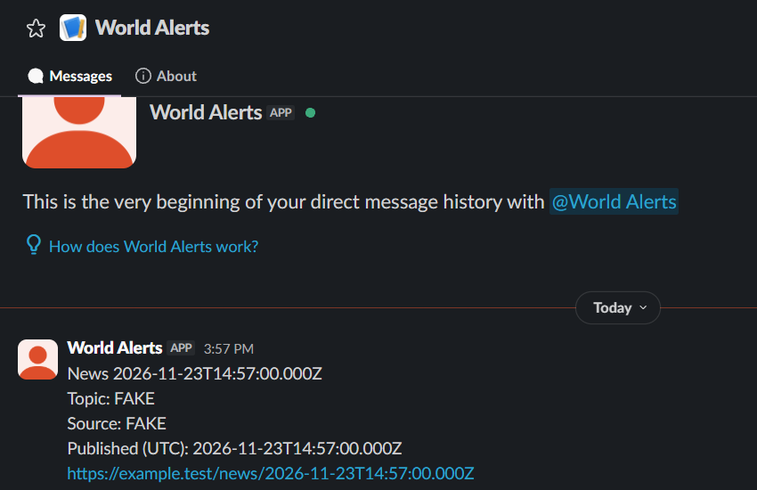
