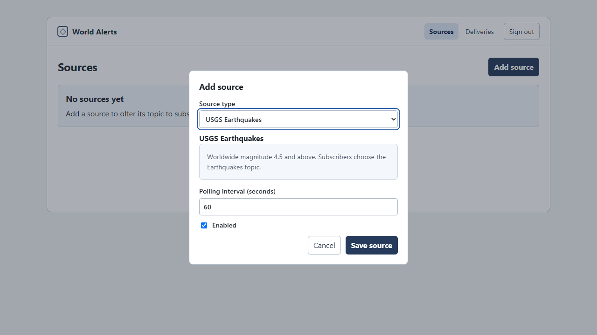
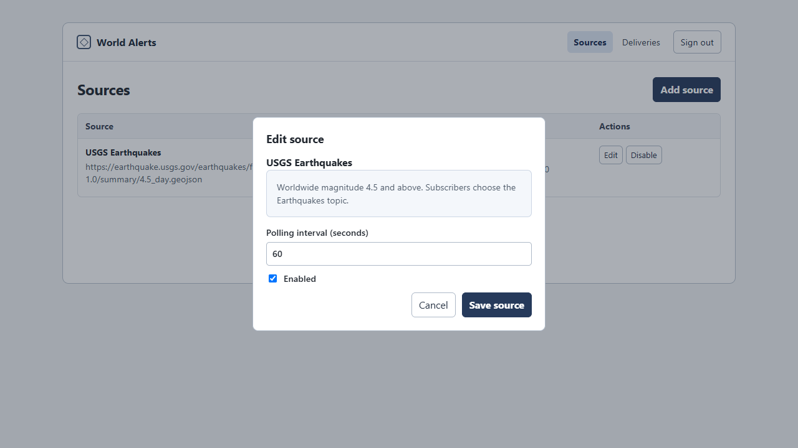
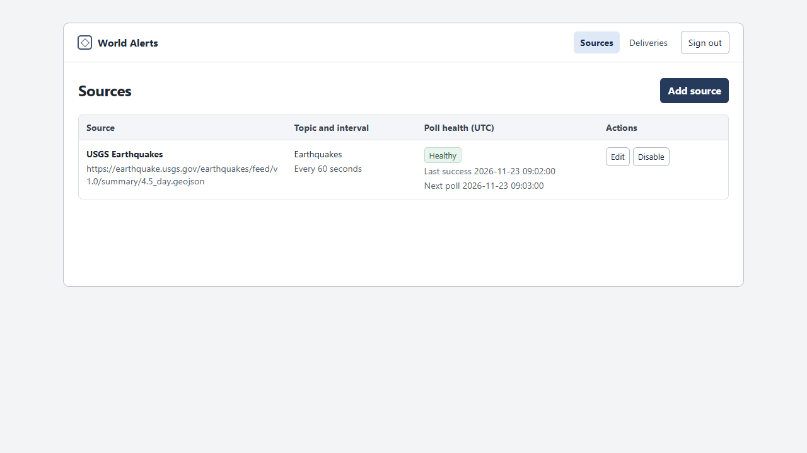
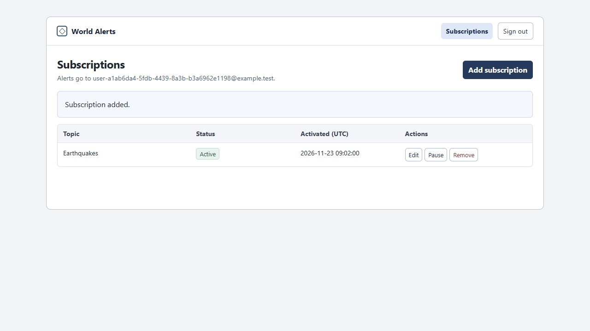
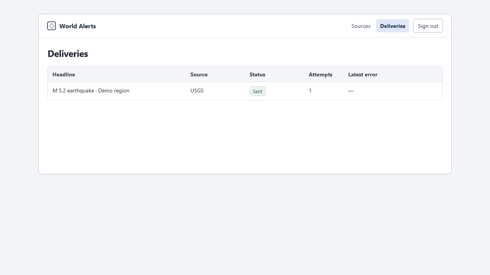
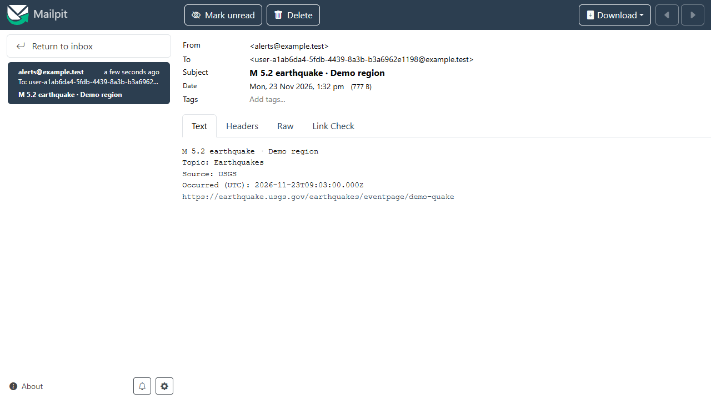

# USGS review evidence

The controlled browser scenario created a USGS source, subscribed a synthetic user, waited for a successful baseline, and delivered one magnitude 5.2 alert to an isolated Mailpit inbox. The replay tests also verified late magnitude qualification, revision deduplication, and retrying a failed catalog range. The separate live scenario verified the real USGS feed, and a direct adapter check verified the live catalog.

**Verification results** · 52 backend tests, 20 Angular tests, and 12 Playwright scenarios passed. The Angular production build passed.

## Add and configure the source

## Poll health

## Subscription and delivery

